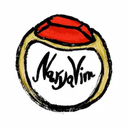
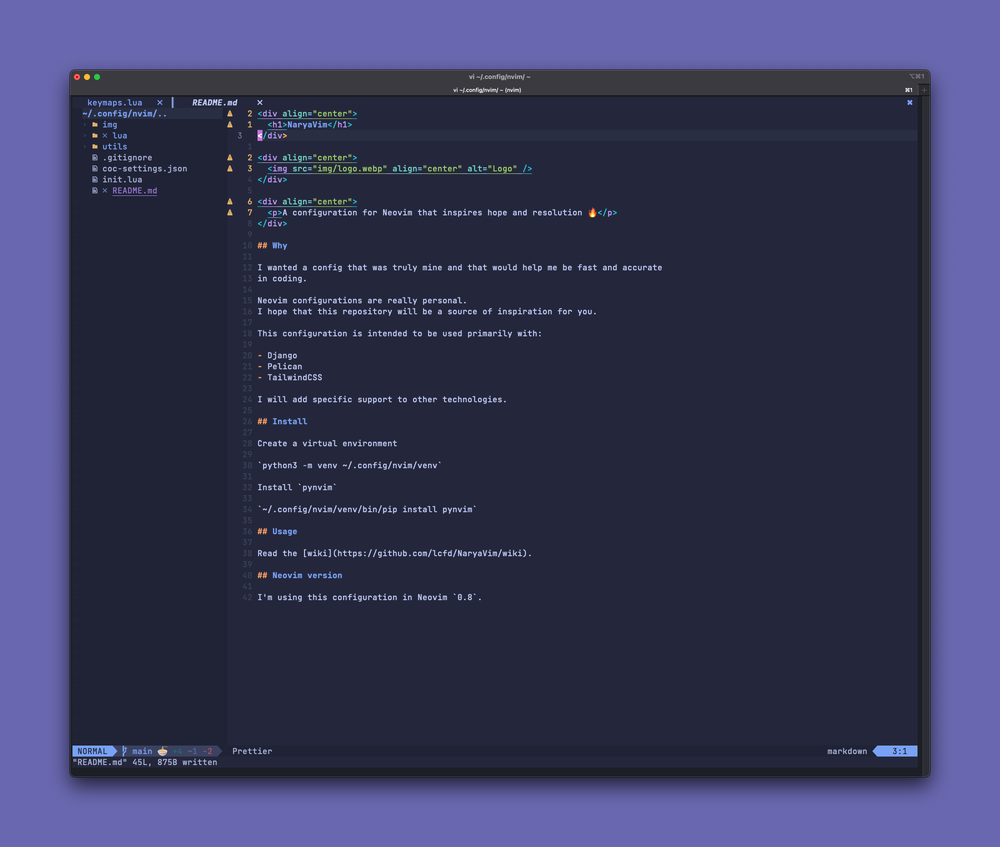

<div align="center">
  
</div>

<div align="center">
  <h1>NaryaVim</h1>
  <p><b>A configuration for Neovim that inspires <br/> hope and resolution 🔥</b></p>
  <p>
    A fast, hand-crafted Neovim setup for full-stack web development:<br/>
    <b>Django · React · Tailwind CSS · HTMX · Alpine.js</b>, with first-class Python and TypeScript support.
  </p>
</div>

<div align="center">
  
  
  
  
  
</div>

<div align="center">
  <a href="#-features">Features</a> ·
  <a href="#-install">Install</a> ·
  <a href="#%EF%B8%8F-keymaps">Keymaps</a> ·
  <a href="https://github.com/lcfd/NaryaVim/wiki">Wiki</a>
</div>

</br>


<!--  -->

## Table of contents

- [Why](#why)
- [✨ Features](#-features)
- [🗣️ Languages](#️-languages)
- [📋 Requirements](#-requirements)
- [📦 Install](#-install)
- [⌨️ Keymaps](#️-keymaps)
- [🔧 Customization](#-customization)
- [🗂️ Project structure](#️-project-structure)
- [📚 Documentation](#-documentation)
- [🤝 Contributing](#-contributing)
- [📄 License](#-license)

## Why

I wanted a config that was truly mine and that would help me be fast and accurate.

Neovim configurations are _really_ personal.
I hope this repository can be more of a source of inspiration than a complete replacement.

For that purpose, there are already excellent distributions such as:

- [LunarVim](https://www.lunarvim.org/)
- [AstroNvim](https://astronvim.com/)

This configuration is intended to be used primarily with:

- [Django](https://github.com/django/django)
- [React](https://github.com/facebook/react)
- [Tailwind CSS](https://github.com/tailwindlabs/tailwindcss)
- [HTMX](https://github.com/bigskysoftware/htmx)
- [Alpine.js](https://github.com/alpinejs/alpine)

## ✨ Features

### 🧠 Code intelligence

- **Native LSP**: servers are configured with Neovim 0.11's built-in `vim.lsp.config` / `vim.lsp.enable` API. No wrapper layers.
- **Zero-setup tooling**: [Mason](https://github.com/mason-org/mason.nvim) installs every language server and formatter, plus the `tree-sitter` CLI, the first time you start Neovim. Servers attach to open buffers as soon as their install finishes.
- **Fast completion**: [blink.cmp](https://github.com/saghen/blink.cmp) with LSP, paths, snippets, signature help and `[[wikilink]]` completion.
- **Snippets**: [LuaSnip](https://github.com/L3MON4D3/LuaSnip) + [friendly-snippets](https://github.com/rafamadriz/friendly-snippets), plus custom snippets for Django templates, HTMX, Django Ninja and react-hook-form. Django snippets are available in Python files, and HTML snippets in JSX, Astro and Vue.
- **Formatting**: [conform.nvim](https://github.com/stevearc/conform.nvim) with ruff, prettier, stylua and gofmt, falling back to the LSP.
- **Docstrings**: generate function and class docs with [neogen](https://github.com/danymat/neogen) (JSDoc/TSDoc for JS/TS).
- **Treesitter**: the `main`-branch rewrite of [nvim-treesitter](https://github.com/nvim-treesitter/nvim-treesitter) for highlighting and indentation, with 30+ parsers installed automatically.
- **Structural editing**: text objects and motions for scopes, functions, classes, loops, arguments and calls.

### 🔭 Navigation and search

- **[snacks.nvim](https://github.com/folke/snacks.nvim) pickers** for files, recent files, live grep, buffer lines, diagnostics, TODOs and every LSP location (definitions, references, implementations, incoming/outgoing calls).
- **Smart symbol outline**: one picker for document symbols. It filters out React hook and callback noise and shows Markdown headings with per-level icons.
- **[Harpoon 2](https://github.com/ThePrimeagen/harpoon)**: pin your working set and jump to it with `<leader>1`–`9`. The pinned files also show in the statusline.
- **[oil.nvim](https://github.com/stevearc/oil.nvim)** to edit the filesystem like a buffer, plus a tree explorer.
- **[nvim-spectre](https://github.com/nvim-pack/nvim-spectre)** for project-wide search and replace.

### 🌱 Git

- [lazygit](https://github.com/jesseduffield/lazygit) in a floating window, including per-file history.
- [gitsigns](https://github.com/lewis6991/gitsigns.nvim) in the gutter and inline blame.
- A dashboard that shows your assigned GitHub issues and PRs (via `gh`) and `git status`.

### 🧪 Python and testing

- **ruff** for linting and formatting, plus **ty** and **pyright** for type checking.
- Switch virtual environments with [venv-selector](https://github.com/linux-cultist/venv-selector.nvim).
- Run pytest suites from the editor with [neotest](https://github.com/nvim-neotest/neotest). It uses your project's `.venv` automatically.

### 📝 Notes and Zettelkasten

- [obsidian.nvim](https://github.com/obsidian-nvim/obsidian.nvim) integration with workspaces, daily notes and templates.
- In-buffer Markdown rendering with [render-markdown.nvim](https://github.com/MeanderingProgrammer/render-markdown.nvim), plus smart bullets and centered writing.
- `[[wikilink]]` completion that works even for loose `.md` files outside any vault or repository.
- **Graph view** (`:Graph`): Obsidian's graph, in your terminal (braille renderer) or in your browser. It supports search filters, color groups, local graphs, and live updates as you edit. [Read more →](lua/custom/graph/README.md)

### 🎁 Built-in extras

- **🎵 MPD music player**: a full [MPD](https://www.musicpd.org/) client with a queue, cover art, playlist management and now-playing info in the statusline. It talks to MPD directly, so you don't need `mpc`. [Read more →](lua/custom/mpd/README.md)
- **🎲 Solo RPG toolkit**: a dice roller (exploding dice, keep-highest/lowest, advantage, fudge dice…) and random tables written in Markdown. It turns on when the working directory contains an `rpg.toml` file.

### 🎨 Interface

- The [Tokyo Night](https://github.com/folke/tokyonight.nvim) theme (night style).
- [noice.nvim](https://github.com/folke/noice.nvim) command palette, [lualine](https://github.com/nvim-lualine/lualine.nvim) global statusline, and floating file labels with [incline](https://github.com/b0o/incline.nvim).
- A dashboard, zen mode, indent guides, scope highlighting and notifications, all from snacks.nvim.
- [which-key](https://github.com/folke/which-key.nvim) lists every shortcut, so you never have to memorize them.

## 🗣️ Languages

| Area | Language servers | Formatter |
| --- | --- | --- |
| Python / Django | `ruff`, `ty`, `pyright` | ruff |
| JavaScript / TypeScript / React | `vtsls`, `eslint` | prettier |
| HTML / Django templates | `html`, `tailwindcss` | prettier |
| CSS / Tailwind | `tailwindcss` | prettier |
| Astro / Vue | `astro`, `vtsls` | prettier |
| Markdown | `marksman` | prettier |
| Lua | `lua_ls` (+ [lazydev](https://github.com/folke/lazydev.nvim)) | stylua |
| JSON / YAML / TOML | `jsonls`, `yamlls`, `taplo` | prettier (JSON) |
| Docker | `dockerls`, `docker_compose_language_service` | |
| Shell / SQL / C | `bashls`, `sqlls`, `clangd` | |
| Go | | gofmt |

To add a server, add it to the `servers` table in [`lua/plugins/lsp.lua`](lua/plugins/lsp.lua).

## 📋 Requirements

| Requirement | Why |
| --- | --- |
| **Neovim ≥ 0.11** | Native LSP config API and nvim-treesitter `main` |
| `git`, a C compiler, `make` | Plugin installation, Treesitter parsers, LuaSnip regex support |
| `node` + `npm` | Most language servers and prettier, installed by Mason |
| `python3` | Python language servers installed by Mason |
| [`ripgrep`](https://github.com/BurntSushi/ripgrep) | Live grep and `:grep` |
| A [Nerd Font](https://www.nerdfonts.com/) | Icons (JetBrainsMono Nerd Font is a good choice) |
| _Optional:_ [`lazygit`](https://github.com/jesseduffield/lazygit), [`gh`](https://cli.github.com/) | Git UI and the GitHub dashboard |
| _Optional:_ MPD, ImageMagick | Music player and cover art |

> [!NOTE]
> You don't need to install the [`tree-sitter`](https://github.com/tree-sitter/tree-sitter) CLI yourself: Mason installs it on first start. If you'd rather use your own, make sure the **CLI** is on your `$PATH`. On macOS that's `brew install tree-sitter-cli`; the plain `tree-sitter` formula only ships the library.

## 📦 Install

1. **Back up your current config** (if you have one):

   ```sh
   mv ~/.config/nvim ~/.config/nvim.bak
   mv ~/.local/share/nvim ~/.local/share/nvim.bak
   ```

2. **Clone NaryaVim**:

   ```sh
   git clone https://github.com/lcfd/NaryaVim ~/.config/nvim
   ```

3. **Start Neovim** and let it install the plugins, language servers and parsers. Watch the progress with `:Lazy` and `:Mason`.

4. **Check your setup** with `:checkhealth`.

Step-by-step instructions for each platform are in the [Install wiki page](https://github.com/lcfd/NaryaVim/wiki/Install).

## ⌨️ Keymaps

The leader key is `<Space>`. Press it and wait: ⭐ **which-key lists every available shortcut.**

| Keys | Action |
| --- | --- |
| `<leader><space>` | Find files |
| `<leader>fw` / `<leader>fW` | Grep the project / grep the word under the cursor |
| `<leader>fo` / `<leader>fi` | Recent files / search the current buffer |
| `<leader>p` / `<leader>o` | File explorer / Oil |
| `-` / `=` / `<leader>1`–`9` | Harpoon: add file / menu / jump |
| `gd` `gr` `gi` `gy` | Definition, references, implementation, type definition |
| `<leader>ds` / `<leader>dS` | Document / workspace symbols |
| `<leader>rn` / `<leader>ca` | Rename / code action |
| `<leader>ff` | Format the buffer |
| `<leader>gg` | Lazygit |
| `<leader>z` | Zen mode |
| `<leader>Gg` / `<leader>Gl` | Global / local note graph |
| `<leader>mm` | MPD command center |
| `<C-\>` | Floating terminal |

The full list is in the [Keystrokes wiki page](https://github.com/lcfd/NaryaVim/wiki/Keystrokes).

## 🔧 Customization

NaryaVim is meant to be forked and bent to your will. Every concern lives in its own file under `lua/plugins/`, and [lazy.nvim](https://github.com/folke/lazy.nvim) loads them automatically: to add a plugin, drop a new spec file in that folder.

Machine-specific settings, like your Obsidian vaults, go in a git-ignored `lua/options.lua`. It's optional, and everything works without it. See the [Options wiki page](https://github.com/lcfd/NaryaVim/wiki/Options).

## 🗂️ Project structure

```
~/.config/nvim
├── init.lua            # Entry point: options → plugins → keymaps → commands
├── lua
│   ├── config/         # Core: options, keymaps, user commands, lazy.nvim bootstrap
│   ├── plugins/        # One file per concern (lsp, completion, ui, git, testing, …)
│   ├── custom/         # Home-made modules: graph view, MPD client, RPG toolkit, …
│   └── utils/          # Small helpers
└── snippets/           # Custom VS Code-style snippets
```

## 📚 Documentation

Detailed guides are in the **[wiki](https://github.com/lcfd/NaryaVim/wiki)**:

- [Install](https://github.com/lcfd/NaryaVim/wiki/Install): platform-specific setup
- [Keystrokes](https://github.com/lcfd/NaryaVim/wiki/Keystrokes): every keymap
- [Python](https://github.com/lcfd/NaryaVim/wiki/Python): Python and Django workflow
- [Markdown](https://github.com/lcfd/NaryaVim/wiki/Markdown): notes, Obsidian and the graph view
- [Options](https://github.com/lcfd/NaryaVim/wiki/Options): local configuration
- [Tips](https://github.com/lcfd/NaryaVim/wiki/Tips): fonts, terminals and more

## 🤝 Contributing

This is a personal configuration, but issues, ideas and pull requests are welcome. If something breaks on your machine, please [open an issue](https://github.com/lcfd/NaryaVim/issues).

Lua code is formatted with [stylua](https://github.com/JohnnyMorganz/StyLua) (`stylua lua/`).

## 📄 License

Released under the [GPL-3.0 License](LICENSE).

Thanks to the authors of all the plugins that make this configuration possible, and especially to [folke](https://github.com/folke) for lazy.nvim, snacks.nvim and friends.
